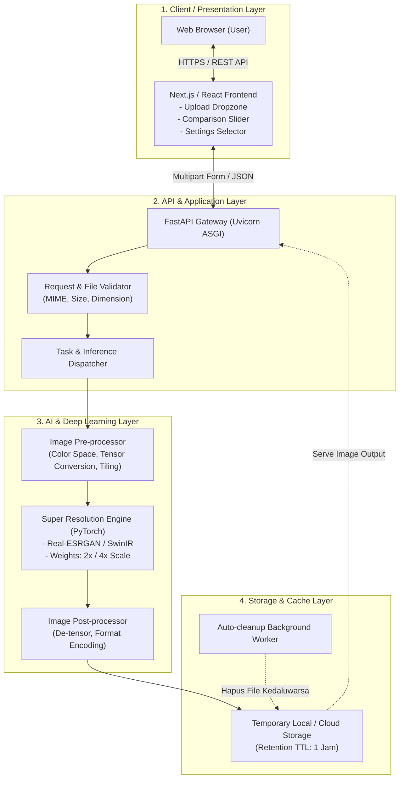
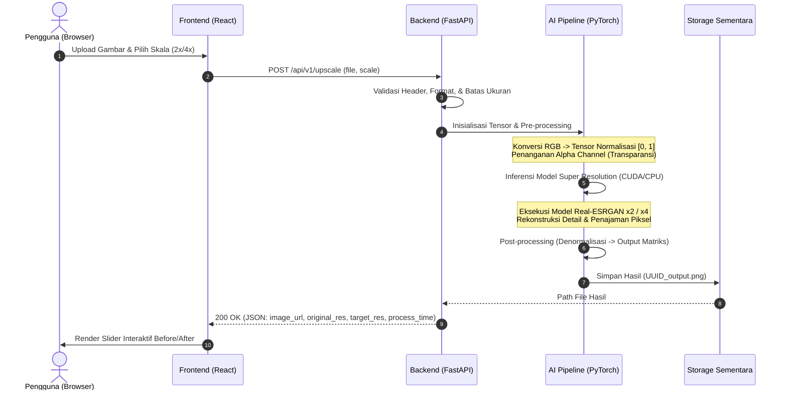

# ItsKirei - System Architecture Document 🏗️

Dokumen ini menjelaskan arsitektur teknis sistem **ItsKirei**, mencakup struktur komponen, pemilihan teknologi (*Tech Stack*), alur *pipeline* inferensi kecerdasan buatan (*AI Inference Pipeline*), pengelolaan memori perangkat keras, serta strategi *deployment* berbasis *cloud*.

---

## 1. Gambaran Umum Arsitektur (High-Level Architecture)

ItsKirei mengadopsi arsitektur terpisah (*Decoupled Client-Server Architecture*) yang memisahkan antarmuka pengguna (*Frontend*) dengan pemrosesan komputasi kecerdasan buatan (*Backend & AI Engine*). Pemisahan ini memastikan UI tetap responsif dan memungkinkan skalabilitas beban kerja inferensi secara mandiri.

---

## 2. Pemilihan Teknologi (Tech Stack)

| Lapisan (Layer) | Teknologi | Alasan Pemilihan |
| :--- | :--- | :--- |
| **Frontend** | **Next.js / React (TypeScript)** | Kinerja cepat, ekosistem UI kaya, penanganan interaktivitas modern (*client-side canvas/slider*). |
| **Styling** | **Tailwind CSS + Lucide Icons** | Desain fleksibel, modern, konsisten, dan ringan sesuai prinsip estetika *Kirei*. |
| **Backend API** | **Python FastAPI + Uvicorn** | Ekosistem native AI/Python, performa asinkron tinggi (ASGI), validasi otomatis via Pydantic, dokumentasi Swagger bawaan. |
| **Deep Learning Framework** | **PyTorch & TorchVision** | Standar industri untuk computer vision & deep learning, dukungan akselerasi CUDA, optimasi komputasi tensor. |
| **AI Model Super Resolution** | **Real-ESRGAN / SwinIR** | Menghasilkan rekonstruksi tekstur realistis pada gambar dunia nyata (*real-world images*) tanpa artefak berlebih. |
| **Image Processing Library** | **OpenCV (cv2) & Pillow (PIL)** | Manipulasi kanal warna (RGB/BGR/Alpha), resizing bicubic/lanczos, dan encoding kualitas tinggi. |
| **Deployment / Container** | **Docker & NVIDIA Container Toolkit** | Portabilitas antar lingkungan (lokal maupun cloud) dengan dukungan passthrough GPU CUDA. |

---

## 3. Pipeline Pemrosesan Citra AI (How It Works)

Bagian ini merinci alur kerja di balik layar (*How It Works*) ketika sebuah gambar diproses oleh sistem:

### Tahapan Detail Pipeline:
1. **Sanitasi & Validasi Input:**
   * Memeriksa *Magic Bytes* berkas untuk memverifikasi format gambar asli (mencegah eksploitasi file ekstensi palsu).
   * Verifikasi batas resolusi maksimum (maksimal input 2048x2048 px untuk menjaga stabilitas VRAM GPU).
2. **Pre-processing:**
   * Ekstraksi kanal transparansi (*Alpha Channel*) jika file berformat PNG transparan.
   * Konversi matriks piksel menjadi Tensor PyTorch dengan rentang float $[0, 1]$.
   * Jika gambar besar mendekati batas VRAM, sistem menerapkan teknik *Tiling* (membagi gambar menjadi beberapa patch kecil dengan overlap padding).
3. **Model Inference (Super Resolution):**
   * Pemilihan bobot model (*model weights*) sesuai parameter pengguna: `RealESRGAN_x2plus.pth` atau `RealESRGAN_x4plus.pth`.
   * Eksekusi komputasi menggunakan `torch.inference_mode()` untuk menghemat alokasi memori grafis.
4. **Post-processing:**
   * Penggabungan kembali hasil inferensi (*de-tiling/blending*).
   * Rekonstruksi kembali kanal alfa jika ada.
   * Encoding hasil akhir ke format lossless PNG atau high-quality JPEG.
5. **Storage & Delivery:**
   * File disimpan dengan penamaan berbasis UUID acak (`uploads/<uuid>_enhanced.png`).
   * Mengirimkan URL akses publik/sementara ke antarmuka klien.

---

## 4. Gambaran Kontrak API (API Contract Overview)

Sistem mengimplementasikan antarmuka REST API asinkron. Detail skema payload, kode respons, dan model data Pydantic didokumentasikan secara lengkap pada [04-api-specification.md](file:///d:/code/itskirei/docs/04-api-specification.md).

* **`POST /api/v1/upscale`:** Menerima multipart/form data (`file` dan `scale`), mengeksekusi inferensi AI, dan mengembalikan tautan serta metadata hasil.
* **`GET /api/v1/health`:** Endpoint pemantauan kesiapan GPU CUDA, pemakaian VRAM, dan status model AI.
* **`GET /static/temp/{filename}`:** Menyajikan berkas gambar hasil olahan dengan batas kedaluwarsa.

---

## 5. Manajemen Hardware & Optimasi Memori (VRAM Management)

Deep learning super resolution membutuhkan alokasi memori grafis (VRAM) yang intensif. Arsitektur ItsKirei menerapkan strategi proteksi berikut:

1. **Inference Mode & No Gradient:** Menggunakan `torch.no_grad()` / `torch.inference_mode()` untuk mencegah komputasi graf backward pass yang tidak diperlukan.
2. **Cache Flushing:** Memanggil `torch.cuda.empty_cache()` setelah inferensi selesai guna mengembalikan blok memori yang tidak terpakai ke sistem.
3. **Patch Tiling Mechanism:** Untuk gambar berdimensi tinggi, proses inferensi dipecah menjadi beberapa ubin kecil (*tiles*) berukuran misal $512 \times 512$ dengan padding agar tidak melebihi kapasitas VRAM 4GB/6GB/8GB.
4. **Fallback Mode (CPU Execution):** Apabila sistem dijalankan pada server tanpa dedicated GPU, sistem secara otomatis beralih ke backend CPU dengan peringatan estimasi waktu proses yang lebih tinggi.

---

## 6. Keamanan & Siklus Hidup File (Security & File Lifecycle)

* **Generasi Nama Unik (UUID):** Nama file asli yang diunggah oleh pengguna tidak disimpan langsung di sistem file server untuk mencegah *path traversal attacks*.
* **Isolasi Berkas:** Direktori penyimpanan sementara dipisahkan dari direktori kode sumber aplikasi.
* **Mekanisme Pembersihan Otomatis (*Auto-cleanup Cron*):**
  * Latar belakang worker menjalankan pengecekan setiap 15 menit.
  * Berkas sementara yang memiliki usia (*timestamp*) lebih dari 1 jam akan dihapus secara permanen dari disk.
* **CORS & Rate Limiting:** Pembatasan domain asal (*Allowed Origins*) dan pembatasan frekuensi pemanggilan request untuk mencegah eksploitasi beban GPU.

---

## 7. Desain Arsitektur Masa Depan (Post-MVP Roadmap)

```mermaid
flowchart LR
    subgraph Client ["Client Apps"]
        WebUI["Web App"]
        ThirdParty["Developer Third-Party"]
    end

    subgraph Gateway ["API Gateway"]
        AuthService["Auth & Rate Limiter<br/>(JWT & API Keys)"]
    end

    subgraph Queue ["Message Broker & Queue"]
        RedisQueue["Redis Task Queue"]
    end

    subgraph Workers ["Scalable AI Worker Nodes"]
        Worker1["GPU Worker 1<br/>(Super Resolution)"]
        Worker2["GPU Worker 2<br/>(Face Restoration / GFPGAN)"]
        Worker3["GPU Worker 3<br/>(Old Photo Restoration)"]
    end

    subgraph Storage ["Cloud Infrastructure"]
        S3Bucket["AWS S3 / Cloudflare R2"]
        DB["PostgreSQL (User & History)"]
    end

    Client --> Gateway
    Gateway --> Queue
    Queue --> Workers
    Workers --> Storage
```

1. **Secondary AI Pipelines:** Integrasi model **GFPGAN / CodeFormer** untuk fitur *Face Restoration*, dieksekusi berurutan setelah tahap super resolution.
2. **Distributed Queue (Celery / Redis):** Menghubungkan gateway dengan kumpulan worker GPU terpisah untuk mendukung pemrosesan massal (*Batch Processing*) tanpa memblokir request HTTP.
3. **Database & Cloud Storage:** Penggunaan PostgreSQL untuk menyimpan relasi akun dan riwayat proses, serta AWS S3/Cloudflare R2 untuk penyimpanan hasil gambar jangka panjang bagi pengguna terdaftar.

