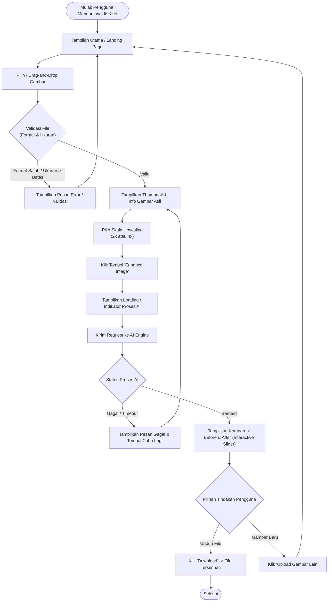
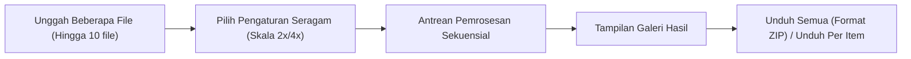
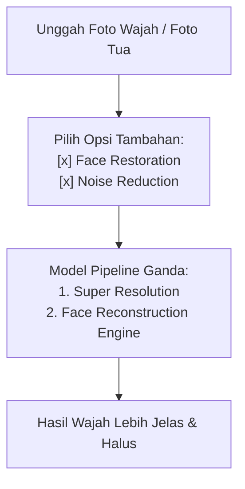
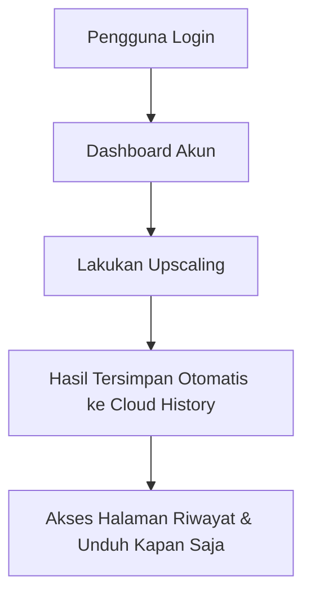
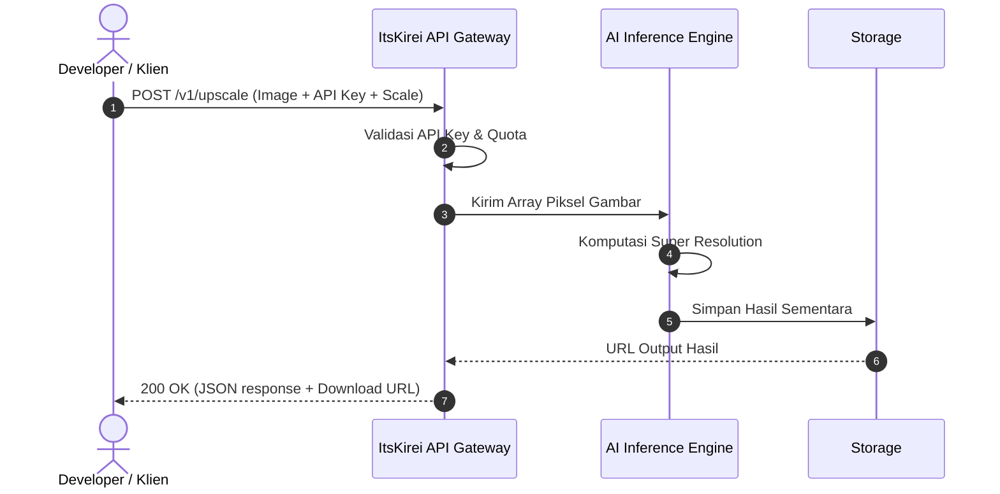

# ItsKirei - User Flow Document 🗺️

Dokumen ini mendokumentasikan alur perjalanan pengguna (*User Flow*) pada platform **ItsKirei**, mencakup tahapan interaksi antarmuka (UI), percabangan logika, penanganan kesalahan (*error handling*), serta alur interaksi fitur masa depan.

---

## 1. Ringkasan Persona & Skenario Penggunaan

### 1.1 Skenario MVP (Tamu / Guest User)
* **Tujuan:** Memperbaiki resolusi satu gambar buram atau kecil secara instan tanpa perlu mendaftar/login.
* **Kebutuhan:** Upload cepat, pilihan opsi perbesaran (2x atau 4x), perbandingan interaktif (*before-after*), dan unduh gambar beresolusi tinggi langsung ke perangkat.

### 1.2 Skenario Pengguna Lanjutan (Post-MVP)
* **Tujuan:** Memproses banyak gambar sekaligus (*batch*), menerapkan *Face Restoration* pada foto potret, atau mengintegrasikan layanan upscaling ke aplikasi pihak ketiga via *API Access*.

---

## 2. Alur Pengguna Utama (Core MVP Flow)

Secara garis besar, alur kerja MVP terdiri dari 5 tahapan utama:
1. **Landing & Upload:** Pengguna masuk ke halaman utama dan memilih gambar.
2. **Validasi & Konfigurasi:** Sistem memvalidasi file; pengguna memilih faktor perbesaran (**2x** atau **4x**).
3. **Eksekusi AI:** Backend menjalankan model Super Resolution; frontend menampilkan status proses.
4. **Inspeksi Hasil:** Pengguna membandingkan detail sebelum dan sesudah menggunakan *comparison slider*.
5. **Unduh:** Pengguna mengunduh gambar hasil perbaikan.

### 2.1 Diagram Alur Utama (Mermaid Flowchart)

---

## 3. Rincian Langkah-demi-Langkah (Step-by-Step Interaction)

### Langkah 1: Akses Halaman & Upload Gambar
* **Antarmuka:** Komponen *Dropzone* yang ramah pengguna dengan tombol *Browse Files* atau area *Drag-and-Drop*.
* **Interaksi:** Pengguna menyeret file gambar atau mengklik area dropzone untuk membuka dialog file di sistem operasi.
* **Kriteria Validasi Sisi Klien:**
  * Format yang didukung: `.jpg`, `.jpeg`, `.png`, `.webp`.
  * Ukuran maksimum: 10 MB.
  * Resolusi maksimum yang direkomendasikan: 2048 x 2048 px (mencegah kehabisan memori GPU).

### Langkah 2: Konfigurasi Parameter
* Setelah file valid terpilih, antarmuka menampilkan:
  * Pratinjau gambar awal (*thumbnail*).
  * Metadata ringkas: Nama file, resolusi awal (contoh: `640 x 480 px`), dan ukuran file.
  * Selector Skala: Pilihan tombol segmen / radio antara **2x** dan **4x**.
  * Prediksi resolusi akhir (contoh: jika 2x dipilih $\rightarrow$ `1280 x 960 px`).
* Tombol CTA utama: **"Enhance Image ✨"**.

### Langkah 3: Pemrosesan AI
* Pengguna mengklik tombol eksekusi.
* Tombol dinonaktifkan (*disabled*) untuk mencegah pengiriman ganda (*multiple submission*).
* Komponen *Loading State* aktif dengan indikator progres atau spinner dinamis dengan status bertahap:
  1. *Uploading image...*
  2. *Enhancing details with AI Super Resolution...*
  3. *Finalizing output...*

### Langkah 4: Komparasi Sebelum & Sesudah (*Before & After*)
* Setelah pemrosesan selesai, antarmuka berpindah ke tampilan hasil.
* **Komponen Komparasi:** *Split Slider* interaktif:
  * Sisi kiri: Gambar Asli (*Original*).
  * Sisi kanan: Gambar Hasil AI (*Kirei Enhanced*).
  * Pengguna dapat menggeser garis pemisah ke kiri dan kanan untuk melihat perbedaan ketajaman secara nyata.
* Opsi tambahan: Fitur zoom untuk memeriksa detail mikroskopik pada tekstur atau tepian gambar.

### Langkah 5: Ekspor & Unduh
* Pengguna mengklik tombol **"Download Result"**.
* Berkas otomatis diunduh dengan penamaan konsisten, misalnya: `itskirei_<nama_asli>_<skala>x.png`.
* Pengguna disediakan opsi tombol **"Enhance Another Image"** untuk kembali ke halaman awal tanpa me-refresh seluruh halaman.

---

## 4. Matriks Status Antarmuka (UI State Matrix)

| State UI | Deskripsi Tampilan | Aksi yang Tersedia |
| :--- | :--- | :--- |
| **Idle / Default** | Dropzone kosong, info format file yang didukung | Upload gambar (klik / drag-and-drop) |
| **File Selected** | Menampilkan thumbnail, info dimensi awal, pemilih skala 2x/4x | Ganti gambar, pilih skala, klik "Enhance Image" |
| **Invalid File** | Notifikasi / alert error (format tidak didukung / ukuran terlalu besar) | Tutup alert, pilih ulang file yang valid |
| **Processing** | Layar abu-abu transparan/skeleton loader, spinner, status teks AI | Batalkan proses (*optional*) |
| **Success** | Komparator slider (Before & After), info resolusi baru | Geser perbandingan, download hasil, upload gambar baru |
| **Error / Failed** | Notifikasi gagal (misal: "Server gagal memproses gambar") | Tombol "Coba Lagi" (*Retry*) atau ganti gambar |

---

## 5. Alur Pengguna Masa Depan (Future User Flows)

### 5.1 Alur Pemrosesan Massal (*Batch Processing*)

### 5.2 Alur Fitur AI Khusus (*Face Restoration & Old Photo Restoration*)

### 5.3 Alur Pengguna Terdaftar (*User Account & History*)

### 5.4 Alur Akses API (*Developer API Access*)

---

## 6. Penanganan Kondisi Khusus (Edge Cases & Error Handling)

1. **Koneksi Terputus saat Upload:**
   * Sistem mendeteksi kegagalan jaringan dan menampilkan pemberitahuan: *"Koneksi terputus. Silakan periksa jaringan Anda dan coba lagi."*
2. **Gambar Beresolusi Terlalu Ekstrem (Contoh: > 4K input):**
   * Peringatan diberikan sebelum proses: *"Gambar input sudah sangat besar. Disarankan menggunakan skala 2x untuk menghindari waktu pemrosesan yang lama."*
3. **Format File Tak Dikenal:**
   * Filter tipe MIME pada input dialog menolak berkas non-gambar secara langsung sebelum file dikirim ke server.
4. **Waktu Inferensi Melebihi Batas (*Timeout*):**
   * Apabila waktu komputasi GPU melebihi 60 detik, request dihentikan dengan rapi dan pengguna diberikan opsi untuk mengulang proses (*Retry*).

